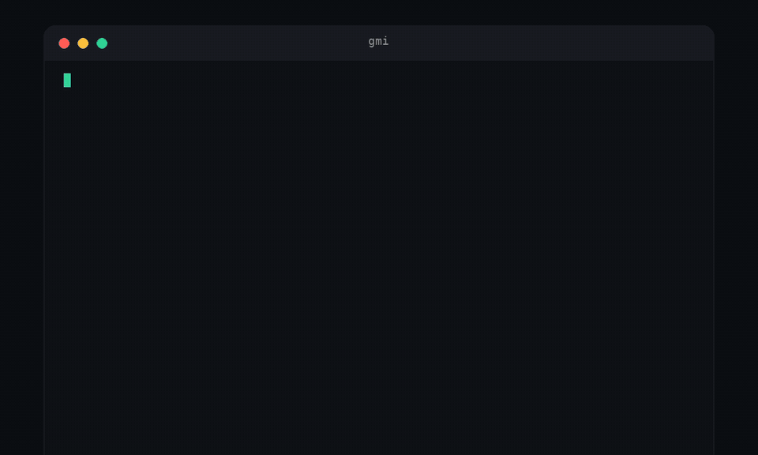
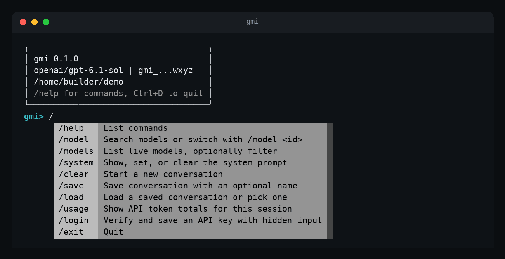
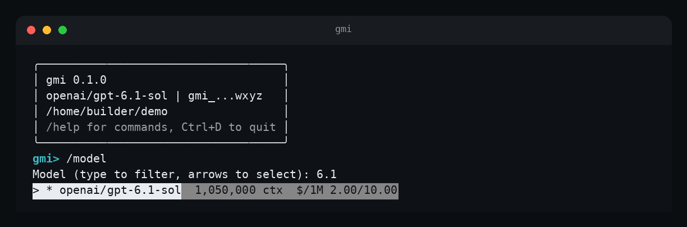
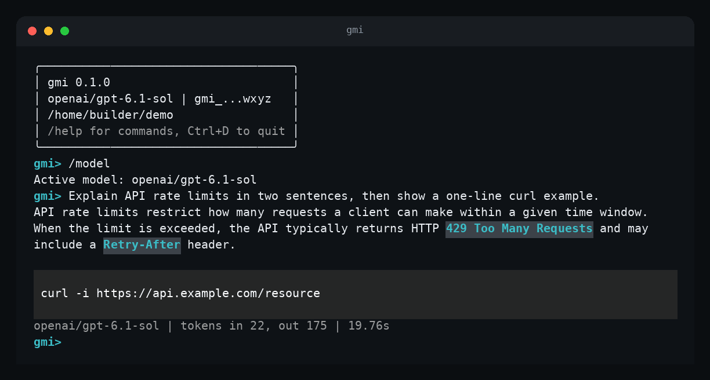
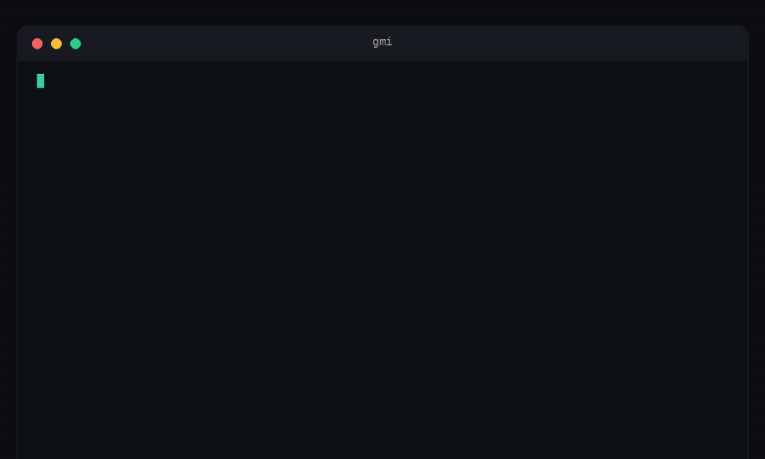

<p align="center">
  
</p>

<p align="center">
  <a href="LICENSE"></a>
  
  
  
  
</p>

<p align="center">
  <b>Chat with any model on <a href="https://www.gmicloud.ai">GMI Cloud</a> from your terminal.</b><br>
  Switch models mid-conversation, see what everything costs and script it all with JSON.
</p>

<p align="center">
  <a href="#install">Install</a> |
  <a href="#quick-start">Quick start</a> |
  <a href="#the-interactive-session">The session</a> |
  <a href="#scripting-and-automation">Scripting</a> |
  <a href="#models">Models</a> |
  <a href="#media">Media</a> |
  <a href="#configuration-and-privacy">Config</a> |
  <a href="#roadmap">Roadmap</a> |
  <a href="#how-its-built">How it's built</a>
</p>

<p align="center">
  
</p>
<p align="center"><sub>A real session against the live API. GPT-6.1 Sol spent about 18 seconds reasoning before it answered; the recording skips most of that wait.</sub></p>

---

## Why gmi

GMI Cloud has an OpenAI-compatible API, a Model Hub and a web console. `gmi` adds a command line to that.

- **A real session, not a one-shot.** Run `gmi` and you stay in a conversation, steered by slash commands like `/model`, in the style of the modern coding agents.
- **Any model GMI serves.** The list comes live from the API, so new models appear without an update. Switch with `/model` and the conversation carries over.
- **Prices in front of you.** Every model shows its context size and USD price per million tokens, straight from the API record.
- **Built for scripts too.** `gmi chat "..." --json`, piped input, clean exit codes, nothing interactive when you ask it not to be.
- **Careful with your key.** Hidden prompt, verified before it is saved, stored with mode 600, never printed.

> [!NOTE]
> **Status: Day 4 of a six-day public build (20 to 25 Oct 2026).** Days 1 to 3 include live API verification. Day 4 adds AgentBox commands and an HTTP service tested offline. Sandbox data plane operations are unverified live and marketplace publication is pending. See the [roadmap](#roadmap) for scope and verification limits.

## Install

Requires Python 3.10 or newer.

```sh
pip install git+https://github.com/zkasuran/gmi
```

Prefer an isolated tool install? Either of these puts `gmi` on your path:

```sh
pipx install git+https://github.com/zkasuran/gmi
uv tool install git+https://github.com/zkasuran/gmi
```

Update later with `pip install --upgrade git+https://github.com/zkasuran/gmi`. You also need an API key: create one in the [GMI Cloud console](https://console.gmicloud.ai) under API Keys (see the [quickstart](https://docs.gmicloud.ai/quickstart)).

## Quick start

```sh
gmi
```

That opens the session. If you are not logged in yet, the banner says so; type `/login`, paste your key (the input is hidden). gmi checks it against the API before saving it. From a plain shell the same thing is:

```sh
gmi auth login          # hidden prompt, verified, saved to ~/.config/gmi/config.toml
gmi auth status         # API reachable. Active key: gmi_...wxyz
```

Already have the key in your environment? Skip login: `export GMI_API_KEY=...` and run `gmi`.

## The interactive session

Type `/` and a menu lists every command. Tab completes. Replies stream in as formatted Markdown with highlighted code blocks. Every reply ends with a dim status line: the model, the token counts the API reported and the time it took.

<p align="center">
  <br>
  <sub>Type <code>/</code> and every command is listed, with a description.</sub>
</p>

<p align="center">
  <br>
  <sub><code>/model</code> opens the picker. Type to filter; context size and price are right there.</sub>
</p>

<p align="center">
  <br>
  <sub>Answers render as Markdown. The dim line under each one shows the model, the API's token counts and the time.</sub>
</p>

### Slash commands

| Command | What it does |
|---|---|
| `/help` | List the commands. |
| `/model` | Open a searchable picker over the live model list. `/model <id>` switches directly. An unknown id is rejected with a "did you mean" hint while your current model stays active. The conversation is kept across switches. |
| `/models` | Table of models with context size and price per 1M tokens. Add filter text to narrow it: `/models sol`. |
| `/system` | Show the system prompt. `/system <text>` sets it and `/system clear` removes it. |
| `/clear` | Start a new conversation. |
| `/save` | Save the conversation to `~/.config/gmi/sessions/<name>.json`. `/save <name>` picks the name, otherwise it is a timestamp. Asks before replacing a saved session. |
| `/load` | `/load <name>` loads a saved conversation. With no name it lists them so you can pick one. |
| `/usage` | Token totals for this session, as reported by the API. |
| `/login` | Verify and save an API key with hidden input. |
| `/exit` | Quit. `Ctrl+D` works too. |

A mistyped command helps you out: `/modle` answers "Unknown command /modle. Did you mean /model?".

### Keys

| Key | Action |
|---|---|
| `Enter` | Send the message. |
| `Alt+Enter` | New line. Also `Shift+Enter` in terminals that report it. Ending a line with `\` then `Enter` works anywhere. |
| `Ctrl+C` | Stop the reply in progress. Text that already arrived stays on screen, but that turn is not added to the conversation, so just ask again. |
| `Ctrl+D` | Quit. |
| `Up`/`Down` | Input history, kept in `~/.config/gmi/history` (mode 600). |
| `Tab` | Complete a slash command. |

In the model picker: type to filter (case-insensitive substring, best match first), arrows to move, `Enter` to pick, `Esc` to cancel. The active model is marked with `*`.

## Scripting and automation

Everything below runs without a session. Add `--json` to any command for machine-readable output with no prompts. Expect a non-zero exit code plus a one-line message on stderr when something fails.

```sh
# Pipe anything in; it is appended to your prompt
gmi chat "Turn these notes into a short checklist" < notes.txt
# - [ ] Review docs
# - [ ] Tag `v1.0` on Sunday
# - [ ] Release on Tuesday

# A commit message from a diff
git diff --staged \
  | gmi chat "Write a commit message for this diff" \
      --system "Reply with one line only."
# Update greeting to say "hello, world"

# The full API response, for jq
gmi chat "Name three HTTP status codes, comma separated, nothing else" --json \
  | jq -r '.choices[0].message.content, .usage.total_tokens'
# 200, 404, 500
# 40

# Find the cheap models: prompt price under $0.30 per million tokens
gmi models --json | jq -r '.data[] | select((.pricing.prompt|tonumber) < 0.0000003) | .id'
```

`gmi chat` with no prompt on a terminal opens the session. With no terminal and no prompt it tells you so instead of hanging.

<details>
<summary><b>Command reference</b></summary>

<br>

**`gmi chat [PROMPT]`**: send a prompt, with standard input appended when piped.

| Option | Meaning |
|---|---|
| `--model TEXT` | Model id. Default: `openai/gpt-6.1-sol`, or `GMI_MODEL`, or your saved default. |
| `--system TEXT` | System instruction. |
| `--max-tokens N` | Maximum output tokens. |
| `--no-stream` | Wait for the complete response instead of streaming. |
| `--no-wrap` | Do not wrap streamed output to the terminal width. |
| `--no-retry` | Do not retry HTTP 429 responses. |
| `--json` | Print the full API response as JSON. |
| `--api-key TEXT` | Use this key (prefer `GMI_API_KEY`, which stays out of shell history). |

**`gmi models`**: list models with context length and USD price per million tokens. `--search TEXT` filters ids and names, `--json` prints the raw records. The current default is marked with `*`.

**`gmi auth`**
- `gmi auth login` verifies a key before saving it. `--stdin` reads it from a pipe: `printf %s "$KEY" | gmi auth login --stdin`.
- `gmi auth status` shows the masked key and checks that the API is reachable.
- `gmi auth logout` removes the saved key. `--yes` skips the confirmation. A key in `GMI_API_KEY` stays active.

**`gmi config get|set KEY [VALUE]`**: read or save a default. Keys: `default_model` (chat), `default_image_model`, `default_video_model`, `default_audio_model` and `sandbox_idc`.

**Global options** (before any command): `--version`, `--api-key TEXT`, `--json`, `--help`.

</details>

## Models

`gmi` reads the model list live from GMI (`GET /v1/models`), so it is never out of date. A session fetches it once and reuses it. At the time of writing that is 82 models, all with prices.

The model for a request is chosen in this order, first match wins:

1. `--model` (or `/model` inside a session)
2. the `GMI_MODEL` environment variable
3. your saved default: `gmi config set default_model <id>`
4. the built-in default, **`openai/gpt-6.1-sol`**

```sh
gmi models --search sol
#   ID                  CONTEXT    PROMPT $/1M  COMPLETION $/1M
#   openai/gpt-5.6-sol  1,050,000  5.00         30.00
# * openai/gpt-6.1-sol  1,050,000  2.00         10.00
#   openai/gpt-6-sol    1,050,000  2.00         10.00
```

Today `gmi` talks to text and media models. See [Media](#media) for image, video and audio commands.

## Media

Generate images, video and audio with any model GMI serves, from the session or from scripts. The catalogue is read live from GMI, so new models show up without an update.

<p align="center">
  
</p>
<p align="center"><sub>A real session. The waiting is shortened; the prices, model names and polling times are the real ones.</sub></p>

In the session:

| Command | What it does |
|---|---|
| `/image <prompt>` | Generate an image. Add `key=value` pairs for model parameters. |
| `/video <prompt>` | Generate a video, for example `/video a paper boat on a pond duration=5`. |
| `/audio <prompt>` | Generate speech or music. |
| `/media` | Pick the default model for image, video or audio from a searchable list. |

From a shell:

```sh
gmi media models --type image          # what you can use right now, with prices
gmi image "a small red lighthouse on a cliff at dawn, flat illustration"
gmi video "a paper boat drifting on a calm pond, soft morning light" --param duration=5
gmi audio "gmi works"
gmi media list --limit 5               # your recent requests
gmi media get REQUEST_ID --out ./gmi-output   # fetch a result you stopped waiting for
```

What a run looks like (real output):

```
gmi> /image a small red lighthouse on a cliff at dawn, flat illustration
Price: $0.0350 per image
Model: seedream-5.0-lite
Saved gmi-output/20261021-005332-seedream-5.0-lite-1.jpg (178194 bytes)
gmi> /video a paper boat drifting on a calm pond, soft morning light duration=5
Price: $0.1100 for 5 seconds ($0.022 / second)
seedance-1-0-pro-fast-251015 dispatched (0s)
seedance-1-0-pro-fast-251015 processing (2s)
seedance-1-0-pro-fast-251015 success (27s)
```

<p align="center">
  <br>
  <sub>The image from that run: 2048 x 2048, made by <code>seedream-5.0-lite</code> for $0.035.</sub>
</p>

**How models are chosen**

- **Only usable models are listed.** A model must be active, visible and have workers. A model with no workers would wait in GMI's queue forever, so gmi hides it.
- **Defaults.** For each type the default is the cheapest listed model that needs only text input. Pin your own with `/media` or `gmi config set default_image_model <id>` (also `default_video_model` and `default_audio_model`). `--model` overrides it for one call.
- **Parameters.** `--param key=value` (or `key=value` after the prompt in the session) sets any parameter in the model's own schema. Values are checked. An enum with a wrong value lists the valid options.

**Prices and files**

- The price is shown before every call, in dollars with the billing unit. It becomes an estimate when the duration or text length is known.
- A call estimated at $0.25 or more asks `Continue? [y/N]`. Scripts pass `--yes`.
- Results are saved to `./gmi-output/` (or `--out DIR`) as `timestamp-model-n.ext`. Downloads need no key.
- Press `Ctrl+C` while waiting and gmi prints the request id. Nothing is cancelled on GMI's side. `gmi media get` brings the file back later.

**Limits**

- Inputs that are images, audio or video must be `http(s)` URLs. Local file paths are not supported yet.
- Some models allow only a few requests per day. gmi tells you when the limit resets and does not retry.
- A provider can be briefly unavailable. gmi retries twice, then says so and leaves the choice of another model to you.

## API commands

Day 3 generates a command for every operation in the four vendored OpenAPI specs. Run `gmi api check --markdown docs/API-COVERAGE.md` with the keys available to your account and see the current results in [docs/API-COVERAGE.md](docs/API-COVERAGE.md).

The generator resolves local references for parameters, request bodies and response schemas. Operation parameters override path-level parameters with the same name and location. Path parameters become required positional arguments. Preview a request without sending it:

```sh
gmi api sandbox get-sandbox SOME_ID --dry-run
```

This prints a URL ending in `/sandboxes/SOME_ID`. Omitting `SOME_ID` is a usage error. The existing tag-group form `gmi api sandbox Sandbox get-sandbox SOME_ID --dry-run` also works.

`gmi api check` skips operations with path parameters with the reason `needs a path parameter`. It also skips operations with missing required query parameters. Supply `idc_name` through `--idc-name` or `GMI_SANDBOX_IDC_NAME`; other required query parameters keep the operation skipped. It probes only GET operations.

| Service | Credential |
|---|---|
| IAM and IDC | The normal inference key from `GMI_API_KEY` or saved settings. |
| Sandbox and Cluster | A compute key from `GMI_COMPUTE_API_KEY` or `GMI_SANDBOX_API_KEY`. |

Create the compute key in the GMI console under API keys and select the compute scope. The inference key uses the `ie_model` scope and is rejected by Sandbox and Cluster.

```text
$ gmi api list --service cluster
cluster  baremetals  create-baremetals  POST  /v1/baremetals  bearerAuth
cluster  baremetals  delete-baremetal  DELETE  /v1/baremetals/{id}  bearerAuth
cluster  baremetals  execute-baremetal-action  POST  /v1/baremetals/{id}/actions  bearerAuth
cluster  baremetals  get-baremetal  GET  /v1/baremetals/{id}  bearerAuth
cluster  baremetals  get-baremetal-products  GET  /v1/baremetals/products  bearerAuth
cluster  baremetals  list-baremetals  GET  /v1/baremetals  bearerAuth
cluster  baremetals  update-baremetal  PUT  /v1/baremetals/{id}  bearerAuth
cluster  containers  container-shell  POST  /v1/containers/{id}/shell  bearerAuth
cluster  containers  create-container  POST  /v1/containers  bearerAuth
cluster  containers  delete-containers  DELETE  /v1/containers/{id}  bearerAuth
cluster  containers  download-log  GET  /v1/containers/{id}/logs  bearerAuth
cluster  containers  get-container  GET  /v1/containers/{id}  bearerAuth
cluster  containers  get-container-products  GET  /v1/containers/products  bearerAuth
cluster  containers  get-containers  GET  /v1/containers  bearerAuth
cluster  containers  restart-container  POST  /v1/containers/{id}/restart  bearerAuth
cluster  containers  update-container  PUT  /v1/containers/{id}  bearerAuth
cluster  elastic-ips  allocate-elastic-ip  POST  /v1/elastic-ips  bearerAuth
cluster  elastic-ips  associate-elastic-ip  POST  /v1/elastic-ips/{id}/associate  bearerAuth
cluster  elastic-ips  disassociate-elastic-ip  POST  /v1/elastic-ips/{id}/disassociate  bearerAuth
cluster  elastic-ips  get-elastic-ip  GET  /v1/elastic-ips/{id}  bearerAuth
cluster  elastic-ips  get-elastic-ip-products  GET  /v1/elastic-ips/products  bearerAuth
cluster  elastic-ips  list-elastic-ip  GET  /v1/elastic-ips  bearerAuth
cluster  elastic-ips  release-elastic-ip  DELETE  /v1/elastic-ips/{id}  bearerAuth
cluster  firewalls  associate-firewall  POST  /v1/firewalls/{id}/associate  bearerAuth
cluster  firewalls  create-firewall  POST  /v1/firewalls  bearerAuth
cluster  firewalls  delete-firewall  DELETE  /v1/firewalls/{id}  bearerAuth
cluster  firewalls  disassociate-firewall  POST  /v1/firewalls/{id}/disassociate  bearerAuth
cluster  firewalls  get-firewall  GET  /v1/firewalls/{id}  bearerAuth
cluster  firewalls  list-firewalls  GET  /v1/firewalls  bearerAuth
cluster  firewalls  update-firewall  PUT  /v1/firewalls/{id}  bearerAuth
cluster  images  get-image  GET  /v1/images/{id}  bearerAuth
cluster  images  list-images  GET  /v1/images  bearerAuth
cluster  templates  create-templates  POST  /v1/templates  bearerAuth
cluster  templates  delete-template  DELETE  /v1/templates/{id}  bearerAuth
cluster  templates  get-template  GET  /v1/templates/{id}  bearerAuth
cluster  templates  get-templates  GET  /v1/templates  bearerAuth
cluster  templates  update-templates  PUT  /v1/templates/{id}  bearerAuth
cluster  vpcs  allocate-default-vpc  POST  /v1/vpcs  bearerAuth
cluster  vpcs  get-vpc  GET  /v1/vpcs/{id}  bearerAuth
cluster  vpcs  list-vpcs  GET  /v1/vpcs  bearerAuth
cluster  vpcs  release-default-vpc  DELETE  /v1/vpcs/{id}  bearerAuth
Total: 41
```

The IDC help and live call were:

```text
$ gmi api idc --help
Usage: gmi api idc [OPTIONS] COMMAND [ARGS]...
Commands:
  idcs
$ gmi api idc idcs list-idcs --json
{"idcs":[{"country":"","countrySubdivision":"","idcId":"global","name":"Global","status":"available"}, ... ]}
```

Dry runs show the complete request and mask secrets:

```text
$ gmi api sandbox Sandbox create-sandbox --dry-run --token gmi_supersecretTOKEN123 --set template_id=demo
{"method": "POST", "url": "https://console.gmicloud.ai/api/v2/sandboxes", "headers": {"Authorization": "Bearer gmi_...N123"}, "body": {"template_id": "demo"}}
$ gmi api cluster baremetals delete-baremetal demo-id --dry-run --token session_secret_123
{"method": "DELETE", "url": "https://console.gmicloud.ai/api/v1/baremetals/demo-id", "headers": {"Authorization": "Bearer gmi_..._123"}, "body": null}
```

| Auth scheme | What it needs |
|---|---|
| none | Sends no auth header. |
| bearerAuth | Saved gmi key by default, or `--token` or `GMI_TOKEN`. |
| bearerAPIKey | Saved gmi key by default, or `--token` or `GMI_TOKEN`. |
| bearerEmailVerificationToken | Required `--token` or `GMI_TOKEN`. |
| sandboxAccessToken | `--host` and `--access-token` or `GMI_SANDBOX_TOKEN`; sends only `X-Access-Token`. |

Every non-GET asks for confirmation. DELETE also says `This deletes data.`. Use `--yes` for an intentional noninteractive call. `--dry-run` works without a key and sends nothing. Binary responses require `--out FILE`.


## `gmi sandbox`: AgentBox

Day 4 adds friendly control plane commands for products, templates, sandbox
creation, inspection, lifetime changes and deletion. Exec, file transfer and
one-shot runs implement the published data plane contract and are **unverified
live**. All Day 4 tests are offline. See [the AgentBox guide](docs/AGENTBOX.md)
for the full command reference and known platform billing deletion.

Use a compute-scope key in `GMI_COMPUTE_API_KEY` or `GMI_SANDBOX_API_KEY`.
The normal inference key cannot authorize these operations. IDC precedence is
`--idc-name`, `GMI_SANDBOX_IDC_NAME`, then `gmi config set sandbox_idc NAME`.
Without a selection, creation omits the field and uses the organization's default.

```sh
gmi sandbox products --idc-name us-central-iowa16
gmi sandbox templates create --name demo --image ubuntu:24.04 \
  --start-cmd 'sleep infinity' --idc-name us-central-iowa16 --wait --yes
gmi sandbox create TEMPLATE_ID --timeout 300 --wait --yes
gmi sandbox list --json
gmi sandbox exec SANDBOX_ID -- sh -c 'printf "hello\n"'
gmi sandbox put SANDBOX_ID ./input.txt /home/user/input.txt
gmi sandbox get-file SANDBOX_ID /home/user/input.txt --out ./output.txt
gmi sandbox timeout SANDBOX_ID 900 --yes
gmi sandbox kill SANDBOX_ID --yes
gmi sandbox run --image ubuntu:24.04 --yes -- uname -a
```

These are usage examples, not live execution results. The owner verified
`us-central-iowa16` and `us-central-iowa2` for this organization. Custom resources
are disabled by the platform. Creation and deletion require confirmation;
`--yes` is required in scripts or with `--json`. Catalog prices appear only when
the response supplies them. Otherwise gmi explains per-second runtime billing
and credits where applicable without inventing a price.

Creation prints the ID and end time. Access and traffic tokens are masked by
default, including in JSON. Only `sandbox create --show-token` reveals them once
with a secret warning. Exec and file operations connect for fresh tokens and send
only `X-Access-Token` to the sandbox host. Exec returns the process exit code.
`run` reuses a matching ready template or builds one, creates and waits for a
sandbox, executes the command and attempts to kill it even on failure or Ctrl+C.

The owner observed immediate platform deletion with
`Sandbox.BillingNoPermission`, initiated by `billing`. gmi stops at the first
response showing deletion and reports the message, code and initiator with a
non-zero exit. It says this is not a gmi error. This path is tested offline;
live exec and file transfer remain blocked by the organization's purchase
permission. Marketplace publication is pending.

## `gmi serve`: HTTP chat service

`gmi serve` listens on `0.0.0.0:$PORT`, default 8080. `GET /health` returns
`{"status":"ok"}`. `POST /chat` accepts `{"message":"Hello","model":"optional/model"}`
and returns `{"model":"...","reply":"...","usage":{...}}`.

On AgentBox, GMI injects `GMI_MAAS_BASE_URL` and `GMI_MAAS_API_KEY` for inference.
For local use the key falls back to `GMI_API_KEY` and the base defaults to
`https://api.gmi-serving.com`. The request model overrides the first model in
`GMI_MODELS`, then the default is `openai/gpt-6.1-sol`. The service appends `/v1`
to a base without it and sends non-streaming chat completions.

Set `GMI_SERVE_TOKEN` to require its bearer token on every route except `/health`.
**Without it the service is open to anyone who can reach it**, allowing calls
billed to the configured account. The AgentBox gateway's own access control is
unverified here. Runtime credentials are never logged or returned.

The service rejects bad JSON with 400 and bodies above 64 KB with 413. Upstream
errors return 502 with a short message and use a 30 second timeout. Offline tests
call the service through HTTP with a local fake upstream. The image was also
built and run locally on 22 October: it runs as a non-root user, reports healthy,
answers a real chat through GMI, rejects a request without the token with 401 and
writes no key to its logs. Pushing the image, GMI injecting the runtime key and
the five marketplace wizard steps ([docs/AGENTBOX.md](docs/AGENTBOX.md)) have not
been done.

## Configuration and privacy

| Path | Contents |
|---|---|
| `~/.config/gmi/config.toml` | Your saved API key and default model. Mode 600. |
| `~/.config/gmi/history` | Session input history. Mode 600. |
| `~/.config/gmi/sessions/*.json` | Conversations saved with `/save`. |

| Variable | Meaning |
|---|---|
| `GMI_API_KEY` | API key. Overrides the saved one. |
| `GMI_MODEL` | Default model for this shell. |

The key is resolved as `--api-key`, then `GMI_API_KEY`, then the saved config.

- **Your key is never printed.** Anywhere it appears it is masked to `gmi_...` plus four characters.
- **Login is checked first.** A key the API rejects is never saved, so an existing saved key is not overwritten by a bad one.
- **One destination.** gmi talks to `api.gmi-serving.com` and nowhere else. There is no telemetry, analytics or update check in the code.
- **Sessions are plain JSON** on your disk. Delete them whenever you like.

<details>
<summary><b>Troubleshooting</b></summary>

<br>

| You see | What it means |
|---|---|
| `not logged in, run /login` (banner) | No key found. Run `/login`, `gmi auth login`, or set `GMI_API_KEY`. |
| `API key rejected (401)` | The key is wrong or revoked. Run `gmi auth login` with a valid one. |
| `Model <id> is overloaded on GMI right now. Wait a minute and retry.` | GMI answered 429 "overloaded". gmi already waited as GMI asked (its `Retry-After`, at most 30 seconds, up to twice). Retry shortly, or pass `--no-retry` in scripts. |
| `Rate limit reached (429)` | You hit a quota. Wait, or check your account limits. |
| `request stays queued` | gmi only lists models that have workers. Choose an active model with `gmi media models`. |
| `Upstream provider temporarily unavailable` | The provider is temporarily unavailable. gmi retries twice, then try another model. |
| `Daily limit reached` | This model has reached its UTC daily limit. Try another model or wait for the reset time. |
| `Model <id> was not found on GMI.` | Check the id with `gmi models --search <text>`. |
| A long pause after you send a message | Reasoning models can think for a while before the first visible word. The spinner says "Waiting for reply". `Ctrl+C` stops it. |
| `Interactive sessions require a terminal` | You ran `gmi` with no terminal attached. Give it a prompt or use `--json`. |

Platforms: developed and tested on Linux. macOS and Windows have not been tested.

</details>

## Roadmap

Built in public, one working piece a day. The rule: nothing gets announced until it runs.

| Day | Date | What | Status |
|---|---|---|---|
| 1 | Tue 20 Oct | The interactive session, `gmi models`, `gmi chat`, login and config | **Shipped** |
| 2 | Wed 21 Oct | `/image`, `/video` and `/audio` in the session, plus scriptable commands | **Shipped** |
| 3 | Thu 22 Oct | Commands generated from GMI's four published OpenAPI specs | **Shipped** |
| 4 | Fri 23 Oct | `gmi sandbox` and `gmi serve` | **Shipped: offline contracts and service tests.** Sandbox data plane unverified live. The image builds, runs and answers locally. Marketplace publication not done. |
| 5 | Sat 24 Oct | `gmi mcp serve`: every operation as an MCP tool for your agents | Planned |
| 6 | Sun 25 Oct | v1.0: docs, install one-liner, good first issues | Planned |

Some of the GMI APIs need a different kind of API key than the inference key gmi uses today. Where that limits what can be verified, the day's write-up will say so rather than claim more.

## How it's built

Every line of code in this repository is written by [Codex CLI](https://github.com/openai/codex) running **`openai/gpt-6.1-sol` on GMI Cloud**, the same API gmi talks to. [`AGENTS.md`](AGENTS.md) is the contract it works from: the schedule, the verified API facts and the rules. Days 1 to 3 include live API checks. Day 4 has offline contract tests with live limits documented above. The interactive app tests use a pseudo-terminal.

## Development

```sh
git clone https://github.com/zkasuran/gmi && cd gmi
python3 -m venv .venv && source .venv/bin/activate
pip install -e ".[test]"

pytest -m "not live and not live_media"  # offline tests, no key needed
GMI_API_KEY=... pytest    # everything, including live tests against the real API
```

`GMI_MEDIA_BASE_URL=... pytest` points media tests at a fake server instead of the live media API.

Live tests make tiny real requests (a few tokens each) and drive the interactive app with `pexpect` and `pyte`.

```
src/gmi/
  cli.py           command line entry point and the scripting commands
  api.py           HTTP client: streaming, retries, error mapping
  config.py        key, model and config file handling
  media.py         media catalogue, requests, pricing and downloads
  app/
    session.py     the interactive loop, banner and key bindings
    commands.py    the slash command registry (new commands plug in here)
    picker.py      the searchable model picker
    renderer.py    Markdown rendering and the status line
    state.py       conversation state, usage totals, save and load
tests/             unit tests and live tests
docs/              images used by this README
```

Issues and pull requests are welcome.

## License

[Apache-2.0](LICENSE). `gmi` is a community project. It is not affiliated with or endorsed by GMI Cloud. GMI Cloud is a trademark of its owner.

Built by [@zkasuran](https://x.com/zkasuran) during the [@GMI_Cloud](https://x.com/GMI_Cloud) takeover, 20 to 25 October 2026.
